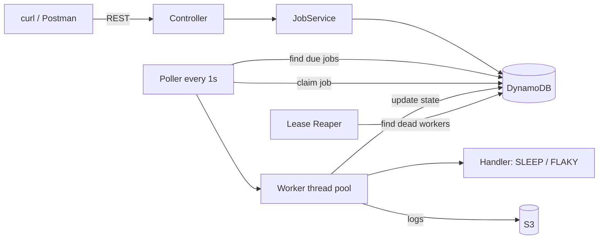
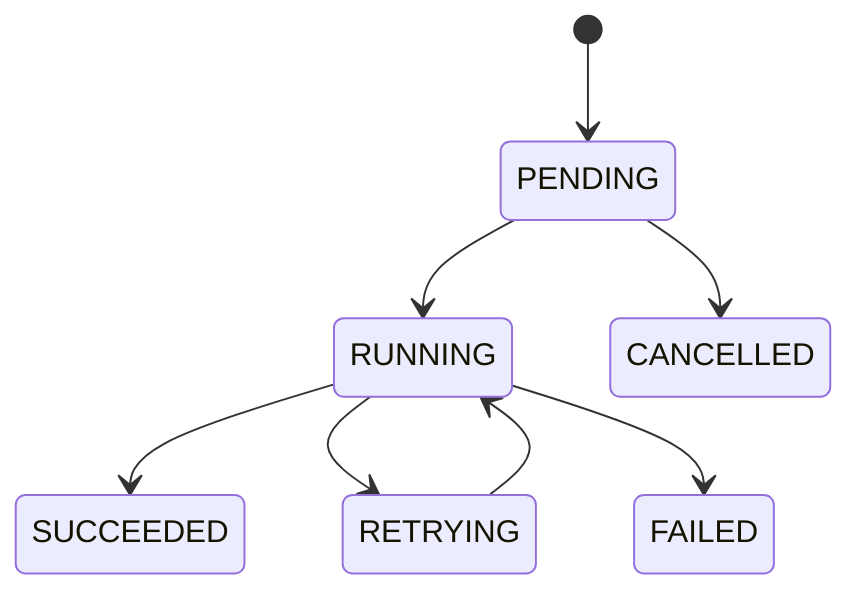

# Orbit-Engine: Explanation for Prabhakar

## 1. Is your understanding right?

Yes. We are building a **job scheduler**: a small version of Quartz or AWS Step Functions.

You give it a job ("run this at 2 AM", "run this once now", "run every 30 seconds"). The system:

1. Saves the job in a database (DynamoDB).
2. Checks every second for jobs that are due.
3. Runs them on a pool of worker threads.
4. Retries failures, waiting longer each time (exponential backoff).
5. Recovers a job if the worker running it crashes.
6. Keeps run history and logs.

And yes, AWS comes last. We build and test everything on your laptop first. DynamoDB runs in a Docker container locally. Only on the deployment days do we point the same code at real DynamoDB, S3 and EC2.

One exception: **open your AWS account and set a billing alarm in the first days.** New accounts sometimes take time to activate, and you do not want that surprise on Day 13.

## 2. What it looks like

Job life:

## 3. Why this project looks good on a resume

Each part maps to something Amazon's job description asks for:

| They want | You show |
|---|---|
| Schedulers | Poller, cron, fixed-rate |
| State machines / workflows | Enforced job lifecycle |
| Multi-threading | Thread pool, graceful shutdown, safe concurrent claiming |
| DynamoDB, S3, EC2 | Real usage of all three |
| REST services | Submit, status, cancel APIs |
| Unit tests | JUnit, Mockito, Testcontainers, coverage |

The strongest selling point is a hard problem solved cleanly: **two workers must never run the same job**. You solve it with DynamoDB conditional writes and prove it with a test (50 jobs, 2 pollers, each runs exactly once). That is what interviewers will ask about.

## 4. What we can realistically build in 2 weeks

You have roughly 35-40 hours, and you are learning while building. The old plan assumed 7 days at 3-4 hours with prior knowledge. For you, 14 days at about 2.5 hours is more honest. So we build in tiers.

**Tier 1: must finish (already a good project)**
- Job state machine with tests
- Save and load jobs in DynamoDB
- Submit and get-status REST APIs
- Thread pool, poller, safe claiming, job runner
- Two demo handlers: SLEEP and FLAKY
- Retries with backoff and a timeout
- Run history
- Unit and integration tests, including the exactly-once test
- A good README

**Tier 2: build if on schedule**
- Crash recovery (lease, heartbeat, reaper)
- Idempotent submit (same key means same job)
- Cron and fixed-rate jobs
- Cancel API
- Logs in S3
- Coverage report (JaCoCo)

**Tier 3: deploy and measure**
- Docker image, EC2, IAM role
- Load test with real numbers for the resume

**Cut first if we fall behind:** report-generation handler, HTTP handler, metrics page, cancelling running jobs, cron, sharding.
**Never cut:** state machine, safe claim, retries, tests, EC2 deploy.

### Honest risks
- **Tier 2 is where time disappears.** Lease and heartbeat logic is tricky. That is why Days 7 and 12 are buffer days.
- **AWS deploy often takes longer than planned** (IAM, security groups, Docker on EC2). Do not leave it to the last day.
- **Resume numbers must be real.** Write throughput and coverage only after you measure them.
- **Spring Boot version:** your generated project uses Boot 4.1.1, but most tutorials are for Boot 3.x. Some imports and starters differ. I recommend switching to 3.5.x so tutorials match what you see. Your call, we decide before Day 1.

## 5. Day-by-day plan

| Day | What | You should know first |
|---|---|---|
| 1 | Docker, DynamoDB Local, AWS account, AWS CLI | DynamoDB basics (section 6) |
| 2 | `JobStatus` enum, JUnit tests, `Job` model | Java enums, JUnit 5 |
| 3 | Repository, DynamoDB SDK, first integration test | Enhanced Client, Testcontainers idea |
| 4 | REST submit/get, validation, error JSON | `@Valid`, `@RestControllerAdvice` |
| 5 | Thread pool, poller, atomic claim | ThreadPoolExecutor, `@Scheduled`, conditional writes |
| 6 | Job runner, SLEEP handler, run history | `Callable`, `Future` |
| 7 | Buffer, review, git commit | none |
| 8 | Backoff, FLAKY handler, timeout | `Future.get(timeout)`, interrupt |
| 9 | Lease, heartbeat, reaper | Scheduled executors |
| 10 | Idempotency, cron, cancel | `TransactWriteItems`, `CronExpression` |
| 11 | S3 logs, the exactly-once test | S3 basics, Awaitility |
| 12 | More tests, JaCoCo, stats, buffer | Mockito |
| 13 | Dockerfile, AWS setup, EC2 deploy | IAM role, EC2, security groups |
| 14 | Load test, README, resume bullets | none |

## 6. What to learn, and when

I will remind you before each day. Below is the list so you can plan. Search phrases are suggestions; pick a short, recent video.

### Before Day 1 (about 2-3 hours total)
1. **DynamoDB basics**: partition key, sort key, items, on-demand billing. Search: "DynamoDB explained in 15 minutes" or "DynamoDB core concepts". You know Azure, so think Cosmos DB / Table Storage, but with stricter key design.
2. **Docker basics**: image vs container, `docker run`, `docker compose`. Search: "Docker in 1 hour".
3. **AWS basics**: region, IAM user vs role, billing alarm. Think "Managed Identity" from Azure.

### Before Day 2
- Java enums with fields and methods, `Map.of`, `EnumSet` (you can learn from the code I write).
- **JUnit 5 basics**: `@Test`, assertions, `@ParameterizedTest`. Search: "JUnit 5 tutorial".

### Before Day 3
- **GSI and sparse index** in DynamoDB. This is the most important DynamoDB idea in the project. Search: "DynamoDB GSI sparse index".
- **Conditional writes** (`ConditionExpression`). Search: "DynamoDB conditional writes optimistic locking".
- Short idea of **Testcontainers** (it starts a Docker container during a test).

### Before Day 4
- Bean Validation (`@NotNull`, `@Min`, `@Valid`) and `@RestControllerAdvice` for error handling.

### Before Day 5 (key concurrency day)
- Race conditions (why two threads doing the same thing is a bug).
- `ThreadPoolExecutor`: core size, max size, queue, rejection policy. Search: "Java ThreadPoolExecutor explained".
- `@Scheduled(fixedDelay)` vs `fixedRate`.

### Before Day 6-8
- `Runnable` vs `Callable`, `Future.get(timeout)`, `Future.cancel`, `Thread.interrupt()`.
- Mockito: `@Mock`, `when/thenReturn`, `verify`. Search: "Mockito tutorial".
- `java.time.Clock` (so tests control time).

### Before Day 9-10
- Lease and heartbeat idea (I will explain in a few lines when we get there).
- `TransactWriteItems`, DynamoDB TTL.
- `ScheduledExecutorService` and graceful shutdown (`shutdown`, `awaitTermination`, `shutdownNow`).

### Before Day 11 / 13
- S3: bucket, key, upload, presigned URL.
- EC2: instance, key pair, SSH, security group.

## 7. How we will work together

For every step:

1. I tell you which topics to know first.
2. I explain in 2-3 lines what we build and why.
3. I write the code for that step only, with plain explanations.
4. I give you the exact commands to run and what success looks like.
5. I ask 2-3 questions so you check you understood.

Sometimes I will ask **you** to write a small class (for example `JobStatus` or the backoff calculation) and I will review it. You will learn faster, and you can defend it in an interview. If you cannot explain a class, we are not done with it.

## 8. Decisions I need from you

1. **Spring Boot 4.1.1 or 3.5.x?** I recommend 3.5.x for more tutorials. Either works.
2. **Lombok:** I suggest using it only on DynamoDB model classes. OK?
3. **S3 during local development:** I suggest a `LogStorage` interface with a local-file version for dev and an S3 version for AWS. This avoids extra tooling. OK?
4. **Is Docker Desktop installed and working?** Run `docker --version` in PowerShell.
5. **Is the AWS account created?** If not, create it now and set a billing alarm.

## 9. Interview talking points you will earn

- Why conditional writes instead of locks, and how they prevent double execution.
- Why GSIs are only "suggestions" (eventual consistency) and the main table is the source of truth.
- At-least-once execution and why handlers must be idempotent.
- Exponential backoff with jitter, and the thundering herd problem.
- Cooperative cancellation vs force kill.
- Why you built a poller instead of using SQS, and when SQS or Step Functions would be the better choice.
- Thread pool sizing, backed by your own load test numbers.

## 10. Next step

Answer the decisions in section 8. Then watch the three "Before Day 1" topics and we start Day 1.
