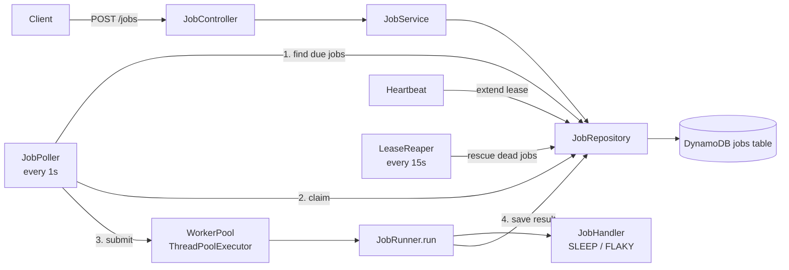
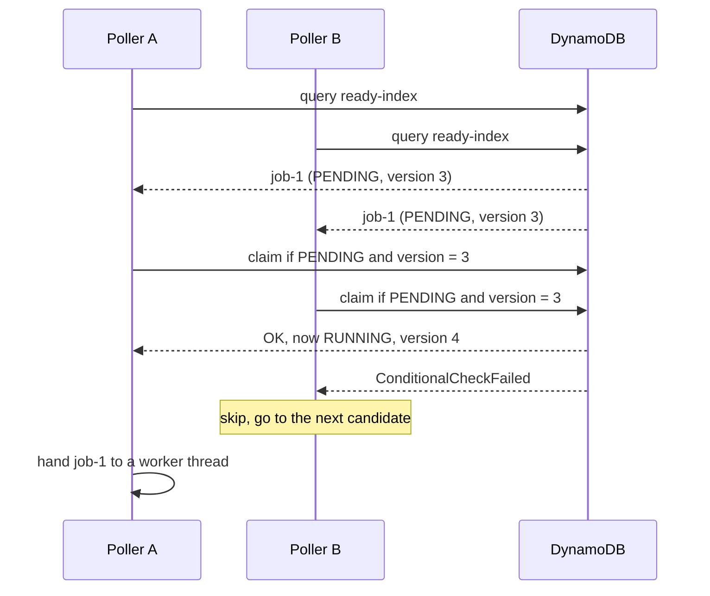
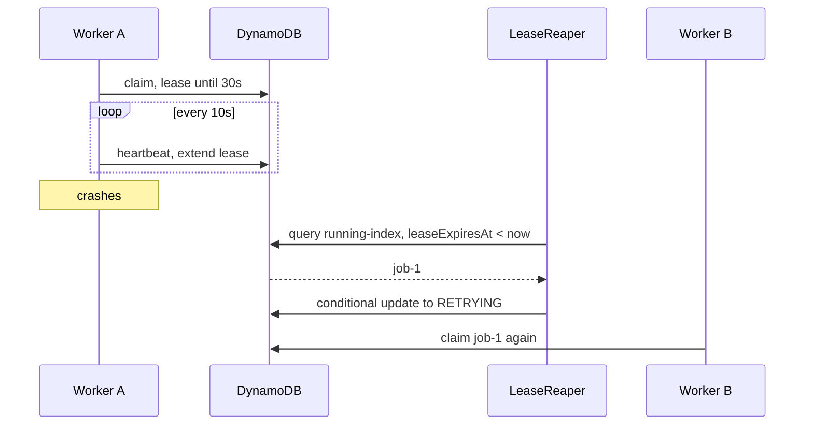

# How Orbit-Engine works, end to end

Read this top to bottom once. Every step says **what happens, which class does it, and what changes in DynamoDB**.

Legend: **[done]** exists in the code today. **[Day N]** comes later in the plan.

---

## 0. The whole thing in one minute

1. A client sends a job as JSON to the REST API.
2. The job is saved in DynamoDB with status `PENDING`.
3. A **poller** wakes up every second and asks DynamoDB: "which jobs are due?"
4. For each due job, the poller tries to **claim** it. Only one claimer can win.
5. The winner hands the job to a **worker thread**, which runs it and writes the result.
6. If a worker dies, a **lease reaper** notices and puts the job back in the queue.



---

## 1. Submit: from JSON to a row in DynamoDB **[done]**

```
Client --> JobController --> JobService --> JobRepository --> DynamoDB
```

| Class | Job | Does NOT do |
|---|---|---|
| `JobController` | Reads the HTTP request, checks the JSON (`@Valid`), returns 201 or an error | Business rules, database |
| `JobService` | Rules: valid type, defaults, picks the shard, sets status `PENDING` | HTTP, DynamoDB calls |
| `JobRepository` | The only class that talks to DynamoDB | Business rules |

`JobService.submit` builds the item. Here is what is stored (a job that should run immediately):

```json
{
  "jobId": "6674426e-...",
  "jobName": "demo",
  "jobType": "SLEEP",
  "payload": "{\"ms\":200}",
  "scheduleType": "ONE_OFF",
  "status": "PENDING",
  "nextRunAt": 1000,
  "attempt": 0,
  "maxAttempts": 3,
  "timeoutSec": 60,
  "version": 1,
  "readyShard": "READY#0",
  "createdAt": 1000,
  "updatedAt": 1000
}
```

Fields to remember:
- `nextRunAt`: the time (epoch milliseconds, UTC) when the job becomes due.
- `version`: a counter that goes up by 1 on every state change. It is a normal attribute in the table. It detects "somebody else changed this job".
- `attempt`: how many times a worker has started this job.
- `readyShard`: makes the job visible in `ready-index`. More on this next.

---

## 2. The two indexes (GSIs): how the poller finds jobs fast

### 2.1 Why an index at all
The table's key is `jobId`. DynamoDB can find a job by `jobId` instantly. But "all jobs that are due" is a different question. Without an index you would have to **scan the whole table** (read every item) every second. An index is a second, automatically maintained copy of the data, organised by different keys.

### 2.2 Sparse index: an item without the key is simply not in the index
An index only contains items that **have its key attribute**. If `readyShard` is missing on a job, that job is **not in the index at all**. It is not "returned as null and skipped". DynamoDB never even looks at it.

We use this on purpose:

| Job situation | `readyShard` | `runningMarker` | In `ready-index`? | In `running-index`? |
|---|---|---|---|---|
| Waiting (PENDING or RETRYING) | present | missing | yes | no |
| Running | **removed** | present = `"RUNNING"` | no | yes |
| Finished (SUCCEEDED, FAILED, CANCELLED) | missing | missing | no | no |

So the "ready" index only ever contains jobs waiting to run, and the "running" index only contains running jobs. A job moves between them just by adding or removing an attribute.

### 2.3 `ready-index`: partition key `readyShard`, sort key `nextRunAt`
- **Partition key `readyShard`** has values like `READY#0`, `READY#1`.
- **Sort key `nextRunAt`**: inside one partition key value, items are stored sorted by this, **earliest first**.

The poller's query:
```
readyShard = "READY#0"  AND  nextRunAt <= now
```
It returns jobs whose time has come, **oldest due job first**, because of the sort order.

**What is a shard, and why?**
- A query needs the partition key **exactly** (`= "READY#0"`). It cannot say "starts with READY". So each shard is a separate query.
- When a job is submitted, the service picks its shard once: `READY# + (hash of jobId) mod numberOfShards`. It stays in that shard.
- Why split at all? All items with the same partition key value live together, and a single value has a throughput limit. With a huge number of due jobs, one value could become a bottleneck. Spreading jobs over N values spreads the load.
- With N shards the poller runs N queries per poll, one for `READY#0`, one for `READY#1` and so on, and combines the results. Ordering is by time **within** a shard only.
- **Today `orbit.poller.shards = 1`**, so only `READY#0` exists. The number is in config, so we can raise it later without changing code. For our scale, 1 is enough; we keep it as a design point to talk about.

### 2.4 `running-index`: partition key `runningMarker`, sort key `leaseExpiresAt`
`runningMarker` always has the same value, `"RUNNING"`. Running jobs are few (bounded by the number of workers), so one value is fine. The sort key is the lease expiry. The reaper asks:
```
runningMarker = "RUNNING"  AND  leaseExpiresAt < now
```
and gets exactly the running jobs whose lease has expired.

### 2.5 Index results are only hints
Indexes are **eventually consistent**: for a moment after a change, an index can show an old picture. So the poller treats index results as **candidates**. The real decision is made by the conditional write in section 4.

---

## 3. The poller: finds due jobs every second **[Day 5]**

```java
@Scheduled(fixedDelay = 1000)           // one thread; next run starts 1s after the last one ends
void poll() {
    int free = freeWorkerSlots();       // pool max - active - queued
    if (free <= 0) return;              // backpressure: don't claim what we cannot run

    List<Job> candidates = repository.findReady(shard, clock.millis(), free);
    for (Job job : candidates) {
        if (repository.claim(job, workerId, now, leaseMs)) {   // the DB decides
            workerPool.submit(new JobRunner(job, ...));        // hand to a thread
        }
    }
}
```

- **`workerId`** is a string that identifies this app instance, for example `my-laptop-3f9a1c` (machine name plus a random part). It is created **once when the app starts**. Two app instances get two different IDs. It is written into the job as `leaseOwner` so everybody knows who owns it.
- **`free`** stops the poller from claiming more jobs than workers can take. A claimed job has a ticking lease, so a job sitting in a long queue would waste lease time.
- The poller itself **never runs a job**. It only finds, claims and hands over.

---

## 4. The claim: how two workers never run the same job **[done, in `JobRepository.claim`]**

### 4.1 The problem
Two pollers (two app instances) can read the same candidate at the same time. Both think "I will run it". We must guarantee only one does.

### 4.2 The solution: one conditional write, decided by DynamoDB
The claim is a single `UpdateItem` call. **DynamoDB itself checks the condition and applies the change in one atomic step**. The check is not done in Java. If Java read the job again and compared, there would still be a gap between the check and the write, and the race would be back.

The condition (all must be true):
```
status IN (PENDING, RETRYING)   -- not already taken or finished
AND nextRunAt <= now            -- it is due
AND version = expectedVersion   -- nobody changed it since we read it
```
- `status` and `nextRunAt` only say "this job is waiting and due". `nextRunAt <= now` **does not mean a worker died**. It simply means the scheduled time has arrived. Dead workers are handled by the reaper (section 8).
- `expectedVersion` is the `version` the poller saw when it read the candidate. If anyone changed the job since (another claim, a cancel), the version is different and the condition fails.

The changes (applied only if the condition holds, all together or none):
```
SET    status = RUNNING
SET    leaseOwner = <workerId>
SET    leaseExpiresAt = now + leaseMs
SET    runningMarker = "RUNNING"      -- job now appears in running-index
SET    updatedAt = now
SET    version = version + 1
SET    attempt = attempt + 1
REMOVE readyShard                     -- job leaves ready-index
```
`nextRunAt` is **not** changed by the claim. It changes later, when the run finishes or is rescheduled.

Real code, simplified:
```java
public boolean claim(Job job, String workerId, long now, long leaseMs) {
    // builds the UpdateItem above, with the condition
    try {
        client.updateItem(request);
        return true;                              // we won
    } catch (ConditionalCheckFailedException e) {
        return false;                             // someone else got there first
    }
}
```

### 4.3 What `true` and `false` mean
- **`true`**: this poller owns the job. The changes above are saved. Hand it to a worker.
- **`false`**: another poller already changed the job. **Nothing was written** by us, so there is nothing to undo. The poller just moves to the next candidate. The job is not lost: the other worker has it. It is not marked failed. Losing a claim is normal, not an error.

### 4.4 Is this sequential or at the same time?
- **Inside one poller**: the `for` loop is sequential. One claim call finishes before the next starts.
- **Between pollers or app instances**: they run at the same time. If two claim the same job, DynamoDB handles the writes to that one item one after another: the first succeeds and bumps the version, the second finds a different version and fails. That is the guarantee.



---

## 5. Handing the job to a worker thread **[Day 5]**

Two different things, do not mix them up:

| Step | What | Where |
|---|---|---|
| **Claim** | Ownership of the job | DynamoDB |
| **Handoff** | Giving the work to a thread | In memory, inside this app |

The `WorkerPool` is a `ThreadPoolExecutor`: a fixed set of worker threads plus a small bounded queue.
```java
new ThreadPoolExecutor(
    4, 4,                           // core == max, from orbit.workers.size
    0L, TimeUnit.MILLISECONDS,
    new ArrayBlockingQueue<>(10),   // bounded queue, from orbit.workers.queue
    threadFactory,                  // names threads orbit-worker-1, 2, ...
    new ThreadPoolExecutor.AbortPolicy());
```
`workerPool.execute(() -> jobRunner.run(claimed))` puts the task in the queue. When a thread is free, it takes the task and runs it.

How the pool decides: fewer threads than core, start a new thread; otherwise queue the task; if the queue is full and threads are below max, start another thread; otherwise reject. **Because extra threads only start once the queue is full, we set core equal to max** (a fixed pool). With separate core and max, jobs would wait in the queue while threads stayed unused.

Why not `Executors.newFixedThreadPool(10)`? It works, but its queue is **unbounded**, so a flood of tasks could grow memory without limit. We use a bounded queue plus the poller's "free slots" check.

Two kinds of threads:
- **Poller thread**: one thread, runs `poll()` every second, never executes jobs.
- **Worker threads**: several, run the slow work (sleep, API call).

---

## 6. `JobRunner.run()`: runs the job and records the result **[Day 6]**

`run()` is the **coordinator**. The real work (calling an API, sleeping) is **not written inside `run()`**. It lives in separate `JobHandler` classes (`SleepHandler`, `FlakyHandler`, later `HttpCallHandler`). The runner picks the right handler by `jobType`.

Steps inside `run()`:
1. Write an execution row (`executions` table): attempt started.
2. Start the heartbeat (section 8).
3. Call `handler.handle(...)` with the job's timeout.
4. Depending on the outcome, update the job with a **conditional write** ("only if I am still the lease owner and it is still RUNNING"):

| Outcome | New status | Other changes |
|---|---|---|
| Success, one-off job | `SUCCEEDED` | remove `runningMarker`, lease fields |
| Success, cron / fixed-rate job | `PENDING` | set the next `nextRunAt`, `attempt = 0`, add `readyShard` back |
| Failure, attempts left | `RETRYING` | `nextRunAt = now + backoff`, add `readyShard` back, keep `lastError` |
| Failure, attempts used up | `FAILED` for a one-off job. A **recurring job** goes to `PENDING` for its next scheduled time instead (decision D18) | remove `runningMarker`; recurring: also set the next `nextRunAt`, add `readyShard`, keep `lastError` |
| Timeout | treated as a failure | |

5. Stop the heartbeat, save the log, finish the execution row.

If the conditional write fails here, it means the lease was lost (the reaper gave the job to someone else). The runner **discards its result** and logs it. This is the "lease lost" case.

---

## 7. Two different kinds of failure

| Case | What happened | Who fixes it |
|---|---|---|
| **Handler fails** | The job code threw an exception or timed out. The worker is **alive**. | `JobRunner` itself sets `RETRYING` or `FAILED` (section 6) |
| **Worker dies** | The process crashed or the machine stopped. Nobody is left to update the job. | The **lease reaper** (section 8) |

Retry timing uses **exponential backoff with full jitter**: wait a random time up to `base * 2^(attempt-1)`, capped. The randomness stops many failed jobs retrying at the same moment.

---

## 8. Lease, heartbeat and reaper: handling dead workers **[Day 9]**

- **Lease**: a time-limited ownership. Written at claim time as `leaseExpiresAt = now + 30s`. It means "this job is mine until then". It is the **lifetime of the ownership**, not "how long to keep trying to claim".
- **Heartbeat**: while the job runs, a timer in the worker extends the lease every 10 seconds, but only if this worker is still the owner and the job is still RUNNING. It says "I am alive".
- **Lease reaper**: a task that runs every 15 seconds. It queries `running-index` for `leaseExpiresAt < now`. Those are jobs nobody has renewed, so the worker is presumed dead. The reaper moves them back to the waiting state.

```
00s  Worker A claims job-1, lease until 30s
10s  heartbeat: lease until 40s
20s  heartbeat: lease until 50s
25s  Worker A crashes, no more heartbeats
50s  lease expired
60s  reaper runs: finds job-1, sets RETRYING, nextRunAt = now (plus backoff),
     removes runningMarker, adds readyShard
61s  a poller claims job-1 again, Worker B runs it
```

Important details:
- The reaper sets the job to **`RETRYING`** (or `FAILED` if attempts are used up), not straight back to PENDING.
- The `attempt` counter was already increased at claim time, so a crashed run counts as an attempt. A job that keeps killing workers will eventually fail instead of looping forever.
- The reaper's update is also conditional (`status = RUNNING AND leaseExpiresAt < now`), so it cannot clash with a worker that just renewed.
- **At-least-once**: Worker A may have done part of the work before dying, and Worker B will do it again. This is why handlers must be **idempotent** (safe to repeat).



---

## 9. One job's life as DynamoDB items

Same job, four moments. Only the interesting fields are shown.

**a) After submit**
```
status=PENDING  nextRunAt=1000  attempt=0  version=1
readyShard="READY#0"            (in ready-index)
```

**b) After a successful claim by worker `host1-ab12` at t=5000, lease 30s**
```
status=RUNNING  attempt=1  version=2
leaseOwner="host1-ab12"  leaseExpiresAt=35000
runningMarker="RUNNING"          (in running-index)
readyShard  REMOVED              (left ready-index)
```

**c) After a heartbeat at t=15000**
```
leaseExpiresAt=45000             (nothing else changes)
```

**d1) After success (one-off)**
```
status=SUCCEEDED  version=3
runningMarker REMOVED, readyShard missing   (in no index)
```

**d2) Or: worker crashed, reaper ran at t=60000**
```
status=RETRYING  attempt=1  version=3  nextRunAt=60000
readyShard="READY#0"             (back in ready-index)
runningMarker REMOVED
```
The next claim makes `attempt=2`, `version=4`.

---

## 10. What exists today and what is coming

| Piece | Status |
|---|---|
| `JobStatus` rules, `Job` model | done |
| `JobRepository.save / findById / findReady / claim` | done, tested against DynamoDB Local |
| REST API: submit and get | done |
| `WorkerPool`, `JobPoller`, `JobHandler` interface | Day 5 |
| `JobRunner`, `SleepHandler`, execution history | Day 6 |
| Retries, backoff, timeout, `FlakyHandler` | Day 8 |
| Heartbeat, `LeaseReaper`, graceful shutdown | Day 9 |
| Idempotent submit, cron, cancel | Day 10 |
| Logs to S3 | Day 11 |

---

## 11. Quick answers to common confusions

- **"Does a missing index key return null?"** No. The item is not in the index at all.
- **"What is the shard prefix for?"** The partition key must be matched exactly. `READY#0`, `READY#1` are separate partition key values, queried one by one.
- **"Is `nextRunAt <= now` the dead-worker check?"** No. It only means the job is due. Dead workers are found by an expired lease.
- **"Who checks the version?"** DynamoDB, inside the conditional write. Not Java.
- **"What if the claim returns false?"** Nothing was written. Skip it and continue. The job belongs to someone else now.
- **"Where does the actual task code live?"** In `JobHandler` classes. `JobRunner.run()` only coordinates.
- **"Does the lease limit how long a job may run?"** No. The heartbeat keeps renewing it. A separate `timeoutSec` limits the run time.
- **"Where does `workerId` come from?"** Generated once at app start (machine name plus a random part).
