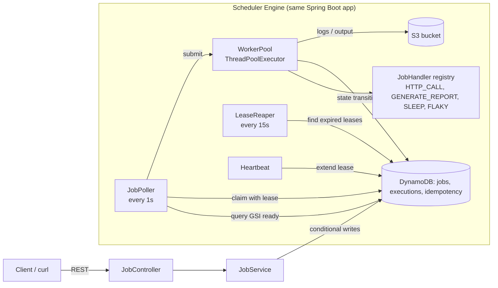
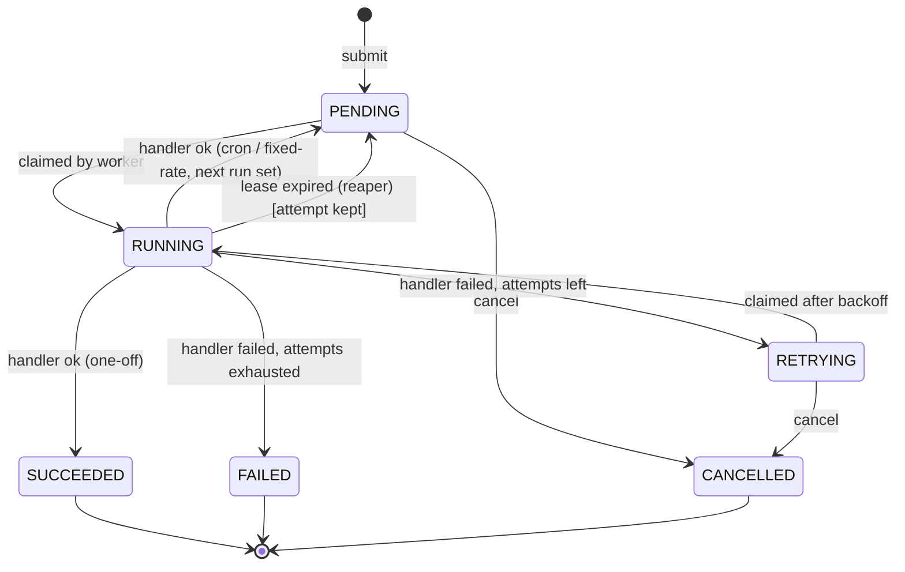

# Job Scheduler & Workflow Engine: Complete Build Plan

**Stack:** Java 17, Spring Boot 3.x, AWS SDK v2 (DynamoDB Enhanced Client + S3), JUnit 5, Mockito, Testcontainers, JaCoCo, Docker, AWS EC2
**Goal:** ek chhota "mini AWS-Step-Functions / mini Quartz" jo jobs ko schedule kare, thread pool pe chalaye, fail hone par retry kare, aur state DynamoDB mein, logs S3 mein rakhe.
**Time:** 7 din (roz 3-4 ghante). Pehle 2 din sabse zaroori hain, baaki uspar banta hai.

> Project ka naam suggestion: `jobflow`. Repo ka README isi plan se banega.

---

## 1. Ye project JD ke kis point ko cover karta hai

| Amazon JD ka point | Project mein kahan |
|---|---|
| Schedulers | Poller + cron / one-off / fixed-rate jobs |
| Workflows, state machines | Job lifecycle state machine (enforced transitions) |
| Multi-threading | `ThreadPoolExecutor`, bounded queue, graceful shutdown, concurrent claim |
| AWS S3, DynamoDB, EC2 | Logs/output S3 mein, state DynamoDB mein, app EC2 pe |
| Web services | REST APIs (submit, status, cancel, history) |
| Unit tests, best practices | JUnit + Mockito + integration tests + JaCoCo |
| Troubleshoot, bottlenecks | Metrics, load test, lease recovery |
| Automate manual tasks | Job handlers (report generation, HTTP call) |
| Simple solutions, no over-engineering | Scope neeche "Non-goals" mein clearly limited hai |

---

## 2. Scope

### Must-have (resume mein jo likha hai wo sab isse aata hai)
1. Job submit karna (one-off, cron, fixed-rate) via REST.
2. Job state machine: `PENDING -> RUNNING -> SUCCEEDED / FAILED / RETRYING / CANCELLED`.
3. Multi-threaded execution (configurable thread pool).
4. Exponential backoff retries with jitter.
5. DynamoDB mein job state, S3 mein execution logs.
6. Idempotent submit (same `idempotencyKey` = same job).
7. Lease + heartbeat + crash recovery (worker mar jaye to job wapas pickup ho).
8. Cancel API, status/history APIs.
9. JUnit/Mockito tests + coverage report.
10. EC2 pe deployed.

### Non-goals (jaan-boojhke nahi bana rahe)
- UI, authentication, multi-tenant, DAG/dependencies between jobs (stretch goal hai), Kubernetes, Kafka/SQS.
- Interview mein bol sakta hai: "SQS use kar sakta tha, par maine poller + conditional writes se khud implement kiya taaki concurrency samajh sakoon."

### Stretch (time bache to)
- Job dependencies (job B tabhi chale jab job A succeed ho).
- Dead-letter listing API, Micrometer metrics dashboard, GitHub Actions CI.

---

## 3. Architecture



**Flow (ek line mein):** client job submit karta hai -> DynamoDB mein `PENDING` -> poller due jobs dhundta hai -> atomic claim karke `RUNNING` -> worker thread handler chalata hai -> success pe `SUCCEEDED` (ya cron ho to wapas `PENDING` next time ke saath), failure pe `RETRYING` with backoff, retries khatam to `FAILED`.

---

## 4. State Machine



Rules:
- Terminal states: `SUCCEEDED`, `FAILED`, `CANCELLED` (inse koi transition nahi).
- Cancel `RUNNING` job ko directly nahi maarta: `cancelRequested=true` set hota hai, handler cooperative check karta hai (`Thread.interrupt()` + flag). Ye interview mein accha talking point hai.
- Har transition DynamoDB mein **conditional write** se hoti hai (neeche dekh).

```java
public enum JobStatus {
    PENDING, RUNNING, RETRYING, SUCCEEDED, FAILED, CANCELLED;

    private static final Map<JobStatus, Set<JobStatus>> ALLOWED = Map.of(
        PENDING,   EnumSet.of(RUNNING, CANCELLED),
        RETRYING,  EnumSet.of(RUNNING, CANCELLED),
        RUNNING,   EnumSet.of(SUCCEEDED, FAILED, RETRYING, PENDING),
        SUCCEEDED, EnumSet.noneOf(JobStatus.class),
        FAILED,    EnumSet.noneOf(JobStatus.class),
        CANCELLED, EnumSet.noneOf(JobStatus.class));

    public boolean canMoveTo(JobStatus next) { return ALLOWED.get(this).contains(next); }
    public boolean isTerminal() { return ALLOWED.get(this).isEmpty(); }
}
```

---

## 5. DynamoDB Schema (sabse important part)

Billing mode: **PAY_PER_REQUEST** (on-demand). Free tier mein chhota load free jaisa hi rahega.

### 5.1 Table `jobs`

| Attribute | Type | Meaning |
|---|---|---|
| **`jobId`** (PK) | S | UUID |
| `name` | S | Human readable naam |
| `type` | S | Handler type: `HTTP_CALL`, `GENERATE_REPORT`, `SLEEP`, `FLAKY` |
| `payload` | S | JSON string (handler ke params) |
| `scheduleType` | S | `ONE_OFF`, `CRON`, `FIXED_RATE` |
| `cronExpr` | S | e.g. `0 */5 * * * *` (CRON ke liye) |
| `fixedRateSec` | N | FIXED_RATE ke liye |
| `status` | S | `JobStatus` |
| `nextRunAt` | N | epoch millis, kab chalna chahiye |
| `attempt` | N | Is cycle ki current attempt (1..maxAttempts) |
| `maxAttempts` | N | default 3 |
| `backoffBaseMs` | N | default 1000 |
| `backoffCapMs` | N | default 60000 |
| `timeoutSec` | N | per-run timeout, default 60 |
| `leaseOwner` | S | worker id (`hostname-threadname`) |
| `leaseExpiresAt` | N | epoch millis |
| `cancelRequested` | BOOL | cooperative cancel flag |
| `version` | N | optimistic locking counter |
| `readyShard` | S | **sparse GSI key**, sirf `PENDING/RETRYING` mein hota hai, e.g. `READY#2` |
| `runningMarker` | S | **sparse GSI key**, sirf `RUNNING` mein = `"RUNNING"` |
| `lastError` | S | Last failure message (truncate 1000 chars) |
| `lastLogKey` | S | S3 key of latest execution log |
| `idempotencyKey` | S | Client supplied (optional) |
| `createdAt`, `updatedAt` | N | epoch millis |

**GSI 1: `ready-index`**
- PK `readyShard`, SK `nextRunAt`.
- Query: `readyShard = :shard AND nextRunAt <= :now`, Limit = free worker slots.
- **Sparse index**: job `RUNNING`/terminal hote hi `readyShard` attribute remove ho jata hai, to index mein sirf "chalne ke liye taiyaar" jobs rehte hain. Ye cost aur speed dono ke liye accha hai.
- **Shard kyun?** Agar saari jobs ek hi partition key (`READY`) pe hoti to hot partition ban jata. `shard = hash(jobId) % N` (N = 4, configurable). Poller saare N shards query karta hai. (Interview mein: "single partition ka throughput limit hota hai, isliye write sharding.")

**GSI 2: `running-index`**
- PK `runningMarker`, SK `leaseExpiresAt`.
- Reaper query: `runningMarker = "RUNNING" AND leaseExpiresAt < :now` -> ye wo jobs hain jinka worker mar gaya.

> GSIs **eventually consistent** hote hain. Poller ko stale result mil sakta hai, isliye **claim hamesha conditional write se** hota hai. GSI sirf "candidates" batata hai, truth main table hai.

### 5.2 Table `executions` (history + audit)

| Attribute | Type | Meaning |
|---|---|---|
| **`jobId`** (PK) | S | |
| **`sk`** (SK) | S | `EXEC#<epochMillis>#<attempt>` (time-sorted history) |
| `attempt` | N | |
| `status` | S | `RUNNING / SUCCEEDED / FAILED / TIMED_OUT / CANCELLED / LEASE_LOST` |
| `workerId` | S | |
| `startedAt`, `finishedAt` | N | |
| `durationMs` | N | |
| `errorMessage` | S | |
| `logS3Key` | S | `logs/{jobId}/{attempt}.log` |

Access pattern: "is job ki saari runs dikhao" = `Query(PK=jobId)`, newest first (`ScanIndexForward=false`).

### 5.3 Table `idempotency_keys`

| Attribute | Type |
|---|---|
| **`key`** (PK) | S |
| `jobId` | S |
| `createdAt` | N |
| `ttl` | N (DynamoDB TTL, 24h) |

Submit hone par **TransactWriteItems**: (1) `PutItem idempotency_keys` with `attribute_not_exists(#key)` aur (2) `PutItem jobs`. Dono saath ya koi nahi. Duplicate key aaye to `TransactionCanceledException` pakad ke purana `jobId` return karo (HTTP 200, naya nahi banta).

### 5.4 Access patterns summary (interview ke liye yaad rakh)

| Query | Kaise |
|---|---|
| Job by id | `GetItem(jobs, jobId)` |
| Due jobs | `Query ready-index` (per shard) |
| Expired leases | `Query running-index` |
| Job history | `Query executions` by jobId |
| List jobs by status (admin) | Stretch: GSI3 `status-index`, ya chhote scale pe `Scan` with filter (document karo ki ye trade-off hai) |

---

## 6. Core Mechanisms (kaise kaam karte hain)

### 6.1 Atomic claim (double-execution se bachna)

Do poller instances ho (ya do threads), to ek hi job do baar nahi chalni chahiye. DynamoDB `UpdateItem` with condition:

```
Condition:  #status IN (:pending, :retrying)
            AND nextRunAt <= :now
            AND version = :expectedVersion

Update:     SET #status = :running,
                leaseOwner = :workerId,
                leaseExpiresAt = :now + :leaseMs,
                runningMarker = :runningVal,
                version = version + :one,
                attempt = attempt + :one,
                updatedAt = :now
            REMOVE readyShard
```

`ConditionalCheckFailedException` aaye = kisi aur ne claim kar liya, chup-chaap skip karo. `status` reserved word hai, isliye `#status` alias use hota hai.

### 6.2 Poller

```text
every 1s:
  free = pool.getMaximumPoolSize() - pool.getActiveCount() - queue.size()
  if free <= 0: return                     # backpressure
  candidates = query ready-index for all shards (nextRunAt <= now), limit = free
  for job in candidates:
      if claim(job): pool.submit(new JobRunner(job))
```
`@Scheduled(fixedDelay = 1000)` ek thread pe chalta hai, isliye poller khud multi-threaded nahi hai, par **instances** ke beech safe hai (conditional write).

### 6.3 Worker pool

```java
new ThreadPoolExecutor(
    coreSize, maxSize, 30, TimeUnit.SECONDS,
    new ArrayBlockingQueue<>(queueCapacity),
    new NamedThreadFactory("jobflow-worker"),
    new ThreadPoolExecutor.AbortPolicy());   // poller already backpressure deta hai
```
Config: `jobflow.workers.core=4`, `max=8`, `queue=50`.

### 6.4 JobRunner (ek execution ka lifecycle)

1. `executions` mein row `RUNNING`.
2. Heartbeat start (har `lease/3` pe `leaseExpiresAt` extend, condition: `leaseOwner = :me AND status = RUNNING`).
3. Handler ko `Future` mein chalao `timeoutSec` ke saath (`future.get(timeout)`), timeout pe `future.cancel(true)`.
4. Outcome:
   - **Success + ONE_OFF** -> `SUCCEEDED`.
   - **Success + CRON/FIXED_RATE** -> `PENDING`, `nextRunAt = computeNext()`, `attempt = 0`, `readyShard` wapas set.
   - **Failure + attempt < maxAttempts** -> `RETRYING`, `nextRunAt = now + backoff(attempt)`.
   - **Failure + attempt >= maxAttempts** -> `FAILED` (cron job ho to bhi `FAILED` ya next cycle pe jaye, ek decision lo aur README mein likho).
5. Heartbeat stop, log buffer S3 pe upload, `executions` row update.
6. Har state change **conditional**: `leaseOwner = :me AND status = RUNNING`. Agar fail ho (lease kho di) to result discard karo, `LEASE_LOST` log karo.

### 6.5 Backoff with jitter

```java
public final class BackoffPolicy {
    public static long delayMs(int attempt, long baseMs, long capMs, Random rnd) {
        long exp = Math.min(capMs, baseMs * (1L << Math.min(attempt - 1, 20)));
        return (long) (rnd.nextDouble() * exp);       // "full jitter"
    }
}
```
Full jitter kyun? Saari failed jobs ek hi time pe retry na karein (thundering herd). `Random` inject karo taaki test deterministic ho.

### 6.6 Lease Reaper (crash recovery)

```text
every 15s:
  expired = query running-index where leaseExpiresAt < now
  for job in expired:
      conditional update: status RUNNING AND leaseExpiresAt < :now
         -> if attempt < maxAttempts: status = RETRYING, nextRunAt = now (+backoff)
            else: status = FAILED, lastError = "worker lost"
```
Isse "at-least-once execution" milta hai. **Isliye handlers idempotent hone chahiye**, ye README mein explicitly likho.

### 6.7 Cron next-run

Spring ka `CronExpression.parse(expr).next(ZonedDateTime)` use karo (extra library nahi). Timezone config mein `Asia/Kolkata`.

### 6.8 Graceful shutdown

`@PreDestroy`: poller stop -> `pool.shutdown()` -> `awaitTermination(30s)` -> bache hue RUNNING jobs ke lease release (status `RETRYING`, attempt rollback) -> `shutdownNow()`.

---

## 7. Handlers (JobHandler interface)

```java
public interface JobHandler {
    String type();
    HandlerResult handle(JobContext ctx) throws Exception;   // ctx: payload, logger, cancel flag
}
```

| Type | Kya karta hai | Kyun |
|---|---|---|
| `SLEEP` | `payload.ms` tak so jata hai | Load test aur concurrency demo |
| `FLAKY` | `payload.failRate` probability pe exception | Retry/backoff demo |
| `HTTP_CALL` | URL pe GET/POST, timeout ke saath, status check | "Service level integration" |
| `GENERATE_REPORT` | N random rows ka CSV banake S3 pe upload, output key return | S3 integration, "automate manual task" |

`JobHandlerRegistry` = `Map<String, JobHandler>` (Spring `List<JobHandler>` inject karke). Unknown type pe submit time pe 400.

---

## 8. REST API

Base: `/api/v1`

| Method | Path | Kaam |
|---|---|---|
| POST | `/jobs` | Job submit (201 new, 200 agar idempotent duplicate) |
| GET | `/jobs/{id}` | Job + current state |
| GET | `/jobs/{id}/executions` | Run history |
| GET | `/jobs/{id}/logs/{attempt}` | S3 presigned URL (10 min) |
| POST | `/jobs/{id}/cancel` | Cancel (202 agar RUNNING) |
| GET | `/jobs?status=FAILED&limit=20` | List (chhoti scale ke liye) |
| GET | `/stats` | Count by status, queue depth, active workers |
| GET | `/actuator/health`, `/actuator/metrics` | Health + metrics |

Submit request:
```json
{
  "name": "nightly-report",
  "type": "GENERATE_REPORT",
  "payload": { "rows": 1000 },
  "schedule": { "type": "CRON", "cron": "0 0 2 * * *" },
  "maxAttempts": 3,
  "timeoutSec": 60,
  "idempotencyKey": "nightly-report-v1"
}
```
Validation (`@Valid`): type registry mein ho, cron valid ho, `maxAttempts` 1..10, `timeoutSec` 1..900. Errors ke liye `@RestControllerAdvice` with proper JSON (`400`, `404`, `409`).

---

## 9. Project Structure

```
jobflow/
├── pom.xml
├── Dockerfile
├── docker-compose.yml            # DynamoDB Local + LocalStack(S3)
├── README.md
├── scripts/
│   ├── create-tables.sh          # aws cli / local
│   └── load-test.sh              # N jobs submit + throughput measure
└── src/
    ├── main/java/com/prabhakar/jobflow/
    │   ├── JobflowApplication.java
    │   ├── api/        JobController, StatsController, dto/, GlobalExceptionHandler
    │   ├── domain/     Job, Execution, JobStatus, ScheduleType, StateMachine
    │   ├── service/    JobService, ScheduleCalculator, BackoffPolicy
    │   ├── engine/     JobPoller, WorkerPool, JobRunner, LeaseReaper, HeartbeatTask
    │   ├── handler/    JobHandler, JobHandlerRegistry, SleepHandler, FlakyHandler,
    │   │               HttpCallHandler, GenerateReportHandler
    │   ├── repo/       JobRepository, ExecutionRepository, IdempotencyRepository
    │   ├── storage/    LogStorage (S3)
    │   └── config/     AwsConfig, EngineProperties (@ConfigurationProperties)
    └── test/java/...   unit/ + integration/
```

**Layering rule:** controller -> service -> repo. Engine classes service/repo ko use karte hain. Repo mein hi DynamoDB ka code, baaki jagah AWS SDK import nahi (testing aasaan).

### Dependencies (pom.xml)
- `spring-boot-starter-web`, `-validation`, `-actuator`
- `software.amazon.awssdk:dynamodb-enhanced`, `software.amazon.awssdk:s3`
- `spring-boot-starter-test`, `org.testcontainers:junit-jupiter`, (`localstack` optional)
- `jacoco-maven-plugin`

### Config (`application.yml`)
```yaml
jobflow:
  workers: { core: 4, max: 8, queue: 50 }
  poller: { intervalMs: 1000, shards: 4 }
  lease:  { ms: 30000, reaperIntervalMs: 15000 }
  timezone: Asia/Kolkata
aws:
  region: ap-south-1
  dynamodb: { endpoint: "", jobsTable: jobs, executionsTable: executions, idemTable: idempotency_keys }
  s3: { bucket: jobflow-logs-<yourname>, endpoint: "" }
```
`endpoint` khali = real AWS, local profile mein `http://localhost:8000` (DynamoDB Local).

---

## 10. Testing Plan

### Unit tests (JUnit 5 + Mockito)
| Class | Kya test hoga |
|---|---|
| `JobStatus` | Har allowed/disallowed transition (parameterized test) |
| `BackoffPolicy` | Seeded `Random`: delay cap se zyada nahi, attempt badhne pe range badhti hai |
| `ScheduleCalculator` | Cron next time, FIXED_RATE next time, timezone |
| `JobService` | Submit validation, idempotent duplicate, cancel PENDING vs RUNNING (repo mock) |
| `JobRunner` | Success, failure+retry, failure+exhausted, timeout, lease lost (mock repo + fake handler) |
| `JobPoller` | Free capacity 0 pe claim nahi karta, claim fail pe skip |

### Integration tests (Testcontainers + DynamoDB Local)
1. Submit -> poll -> run -> `SUCCEEDED` (end-to-end).
2. **Concurrency test (headline test):** 50 jobs, 2 poller instances, 8 threads each -> har job **exactly once** `RUNNING` hua (execution count == 50).
3. Retry flow: FLAKY (failRate=1.0, maxAttempts=3) -> 3 executions -> `FAILED`.
4. Lease recovery: job claim karke runner kill karo -> reaper job ko `RETRYING` karta hai.
5. Idempotency: same key se 2 submit -> ek hi `jobId`.

### Coverage
JaCoCo report: `mvn verify` -> `target/site/jacoco/index.html`. Target 70%+ (engine + service pe focus, DTO/config pe nahi). README mein badge/screenshot.

---

## 11. Deployment (AWS)

**Resources (ap-south-1):**
1. **DynamoDB**: 3 tables on-demand + 2 GSI + TTL on `idempotency_keys.ttl`.
2. **S3 bucket**: private, block public access, lifecycle rule: logs 30 din baad delete.
3. **IAM Role for EC2** (access keys code mein kabhi nahi): inline policy sirf `dynamodb:*Item, Query, TransactWriteItems` on 3 tables + indexes, aur `s3:PutObject/GetObject` on bucket. (Least privilege, interview mein poocha jata hai.)
4. **EC2** `t3.micro` (free tier eligible region/plan check kar), Amazon Linux 2023, Security Group: 22 (sirf apna IP), 8080 (apna IP ya demo ke time open).
5. App: Docker image -> EC2 pe `docker run -d --restart unless-stopped -p 8080:8080 -e SPRING_PROFILES_ACTIVE=aws jobflow`.

**Dockerfile (multi-stage):**
```dockerfile
FROM maven:3.9-eclipse-temurin-17 AS build
WORKDIR /app
COPY pom.xml .
RUN mvn -q dependency:go-offline
COPY src ./src
RUN mvn -q -DskipTests package

FROM eclipse-temurin:17-jre
WORKDIR /app
COPY --from=build /app/target/*.jar app.jar
ENTRYPOINT ["java","-jar","app.jar"]
```

**Steps:** AWS billing alarm ($1) pehle lagao -> tables banao -> bucket -> IAM role -> EC2 launch with role attach -> Docker install -> image build/pull -> run -> `curl http://<ec2-ip>:8080/actuator/health`.
**Cost safety:** demo ke baad EC2 stop karo, tables on-demand hain (idle = ~0).

---

## 12. Load Test (resume ke numbers yahan se aayenge)

`scripts/load-test.sh`:
1. 1000 `SLEEP` jobs (`ms=200`) submit karo (curl loop ya chhota Java/Python script, parallel).
2. Start time note karo, jab `/stats` mein `SUCCEEDED == 1000` ho tab end time.
3. `throughput = 1000 / minutes`.
4. 3 baar chalao, median likho. Workers 4, 8, 16 pe compare karo (ek chhoti table README mein).

Theoretical check: 8 workers, 200ms job = ~40 jobs/sec max = 2400/min. Real number kam aayega (DynamoDB round trips, poller interval), wahi **asli number** hai. Wahi resume mein likhna, aur interview mein bata ki bottleneck kya tha (poller interval? DynamoDB writes? thread count?).

Coverage number JaCoCo se aayega. Dono ko resume ke `XX` mein bhar dena.

---

## 13. Day-wise Plan

| Din | Kaam | Done kab maanein |
|---|---|---|
| **1** | Repo + Spring Boot skeleton. AWS account/billing alarm. Docker: DynamoDB Local. Tables + GSIs script. `JobStatus` enum + tests. `Job` entity + `JobRepository` (put/get/conditional update). | Test se job save/get ho raha hai local DynamoDB pe |
| **2** | `POST /jobs`, `GET /jobs/{id}`, validation, error handler. Idempotency (TransactWrite). `ScheduleCalculator` + tests. | curl se submit/duplicate submit sahi chal raha hai |
| **3** | `WorkerPool`, `JobPoller`, atomic claim, `JobRunner` basic, `SLEEP` handler, executions table. S3 `LogStorage`. | Job submit -> `SUCCEEDED`, log S3 pe |
| **4** | Retries + backoff, `FLAKY`, timeout, heartbeat, `LeaseReaper`, cron/fixed-rate re-schedule, cancel API, graceful shutdown. `HTTP_CALL` + `GENERATE_REPORT`. | Retry/recovery manually demo ho jata hai |
| **5** | Unit tests + Testcontainers integration (concurrency test sabse pehle). JaCoCo. Actuator metrics + `/stats`. | `mvn verify` green, coverage report |
| **6** | Dockerfile, AWS resources, IAM role, EC2 deploy. Load test + numbers. | EC2 pe curl se job chala, throughput note |
| **7** | README (architecture diagram, schema, state machine, trade-offs, load numbers), cleanup, GitHub push, resume `XX` bharo, interview prep. | Repo public, README complete |

Agar time kam pade to cut karne ki order: `GENERATE_REPORT` -> cron -> cancel RUNNING -> metrics. **Mat kato:** state machine, atomic claim, retries, tests, EC2.

---

## 14. Seekhne ke topics (JUnit/Mockito + concurrency)

**JUnit 5 + Mockito (1 din ke andar ho jata hai):**
- `@Test`, `@BeforeEach`, `@ParameterizedTest`, `assertThrows`, `assertEquals`.
- Mockito: `@Mock`, `@InjectMocks`, `when(...).thenReturn(...)`, `verify(...)`, `ArgumentCaptor`.
- Pattern: Arrange-Act-Assert. Time ko `Clock` inject karke control karo (`Clock.fixed`), `Thread.sleep` tests mein avoid karo (`Awaitility` use karo async ke liye).

**Java concurrency (is project ke liye jo chahiye):**
- `ThreadPoolExecutor` params (core/max/queue/rejection), `Future.get(timeout)`, `ExecutorService.shutdown/awaitTermination`.
- `AtomicInteger/AtomicLong`, `ConcurrentHashMap`, `volatile` kab.
- `Thread.interrupt()` aur cooperative cancellation.
- Race condition kya hai aur conditional write usse kaise bachata hai (optimistic locking).

---

## 15. Interview Q&A (isi project se)

1. **"Do workers ek hi job na uthaayein, kaise?"** -> DynamoDB conditional `UpdateItem` (status + version check). Jo fail hua wo skip karta hai. Optimistic locking.
2. **"Worker beech mein crash ho gaya to?"** -> Lease + heartbeat. Reaper expired lease wali jobs ko `RETRYING` karta hai. Semantics: at-least-once, isliye handlers idempotent.
3. **"Exactly-once kyun nahi?"** -> Distributed system mein practically at-least-once + idempotency milta hai. Maine idempotency key submit pe di hai.
4. **"Retry ek saath na ho jayein?"** -> Exponential backoff + full jitter.
5. **"Poller aur DynamoDB ka bottleneck?"** -> Sparse GSI, sharded key, free capacity ke hisaab se limit, load test ke numbers.
6. **"GSI eventually consistent hai to dikkat?"** -> Candidate finding ke liye theek, truth main table ka conditional write hai.
7. **"SQS kyun nahi?"** -> Scheduling by time, state history aur retry control ek jagah chahiye tha, aur concurrency seekhna goal tha. Production mein SQS/Step Functions bhi consider karta.
8. **"Thread pool size kaise decide ki?"** -> I/O-bound handlers ke liye cores se zyada, load test se compare kiya (4/8/16).
9. **"State machine kaise enforce hoti hai?"** -> Enum mein allowed transitions + DB condition dono (code aur DB level).
10. **"Cancel RUNNING job?"** -> Cooperative: flag + interrupt, force kill nahi (thread safely kill nahi hoti Java mein).

---

## 16. Resume mein final bullets (jab project ban jaye)

Abhi jo bullets hain unmein ye add kar sakta hai, **sirf asli measured values ke saath**:
- "...load-tested at **N jobs/min** with **W workers**."
- "...**N%** line coverage (JaCoCo) across unit and Testcontainers integration tests."
- "Guaranteed single execution per job under concurrent workers using DynamoDB conditional writes (verified by a 50-job, 2-instance concurrency test)."

---

## 17. Common galtiyan (pehle se bach ja)

- `status` DynamoDB reserved word hai: hamesha `#status`.
- Numbers `N` type hote hain, SDK mein `AttributeValue.builder().n("123")`.
- `Scan` production pattern nahi hai, sirf admin list ke liye chhote scale pe, README mein bata.
- Heartbeat ke bina long job ka lease expire ho jayega aur reaper use dobara chala dega.
- `@Scheduled` mein exception aaye to wo thread band nahi hota par log zaroor karo, try/catch lagao.
- Access keys code ya git mein mat daalo (IAM role / env vars / `~/.aws`). `.gitignore` mein `.env`.
- Time ke liye hamesha epoch millis (UTC) store karo, display pe timezone lagao.

---

## 18. Final checklist

- [ ] State machine tests green
- [ ] Concurrency test green (exactly-once)
- [ ] Retry + backoff demo ho gaya
- [ ] Lease recovery demo ho gaya
- [ ] S3 pe logs aa rahe hain
- [ ] JaCoCo report + % note kiya
- [ ] EC2 pe live, `curl` se verified
- [ ] Load test numbers 3 runs ke median ke saath
- [ ] README: architecture, schema, state diagram, trade-offs, how to run
- [ ] Resume ke `XX` asli numbers se bhare
- [ ] Stationery app bhi EC2 pe deployed
